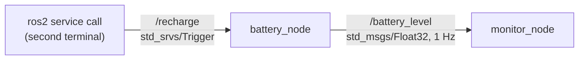

# Underwater Vehicle Battery Tracking (ROS 2 Jazzy)

[](https://github.com/Repla09/ros2-battery-tracking/actions/workflows/ci.yml)

The battery of an underwater vehicle drains over time. This repository is a ROS 2 workspace with one
package, `battery_odev`, that contains two nodes:

- **`battery_node`** simulates the battery: it publishes the battery level and offers a service that
  recharges it.
- **`monitor_node`** prints every battery reading and warns while the battery is low.



## Interfaces

| Name | Kind | Type | Description |
|---|---|---|---|
| `/battery_level` | topic, published by `battery_node` | `std_msgs/msg/Float32` | Battery level in percent. Starts at 100, drops by 1 every second, never goes below 0. |
| `/recharge` | service, served by `battery_node` | `std_srvs/srv/Trigger` | Sets the level back to 100 and replies `success: true`, `message: "Battery recharged"`. |

`monitor_node` subscribes to `/battery_level` and prints each value. While the level is **below 20 %**
every reading is logged as a warning. As soon as the level is back at 20 % or more, it logs
"warning cleared" once and the readings are normal info messages again.

## Requirements

- Ubuntu 24.04
- ROS 2 Jazzy (`ros-jazzy-ros-base` is enough) and the build tools (`ros-dev-tools`)

## Build

The repository itself is the workspace:

```bash
git clone https://github.com/Repla09/ros2-battery-tracking.git
cd ros2-battery-tracking
source /opt/ros/jazzy/setup.bash
rosdep install --from-paths src --ignore-src -y
colcon build
source install/setup.bash
```

## Run

Terminal 1, start both nodes:

```bash
ros2 launch battery_odev battery.launch.py
```

Terminal 2, recharge the battery:

```bash
source /opt/ros/jazzy/setup.bash
ros2 service call /recharge std_srvs/srv/Trigger
```

From 100 % it takes about 80 seconds to reach the warning. To see it sooner, start with a lower level:

```bash
ros2 launch battery_odev battery.launch.py initial_level:=22.0
```

Output of that run, recharged from the second terminal at 18 % (timestamps removed):

```text
[battery_node-1] [INFO] [battery_node]: Battery at 22.0%, draining 1% every 1 s
[monitor_node-2] [INFO] [monitor_node]: Battery level: 22.0%
[monitor_node-2] [INFO] [monitor_node]: Battery level: 21.0%
[monitor_node-2] [INFO] [monitor_node]: Battery level: 20.0%
[monitor_node-2] [WARN] [monitor_node]: Battery level: 19.0% - LOW (below 20%)
[monitor_node-2] [WARN] [monitor_node]: Battery level: 18.0% - LOW (below 20%)
[battery_node-1] [INFO] [battery_node]: Recharged from 18.0% to 100.0%
[monitor_node-2] [INFO] [monitor_node]: Battery level: 100.0% - warning cleared
[monitor_node-2] [INFO] [monitor_node]: Battery level: 99.0%
[monitor_node-2] [INFO] [monitor_node]: Battery level: 98.0%
```

Second terminal:

```text
response:
std_srvs.srv.Trigger_Response(success=True, message='Battery recharged')
```

## Parameters

The defaults are the values from the assignment.

| Node | Parameter | Default | Meaning |
|---|---|---|---|
| `battery_node` | `initial_level` | `100.0` | Level at start (also a launch argument) |
| `battery_node` | `drain_step` | `1.0` | Percent removed per update |
| `battery_node` | `update_period` | `1.0` | Seconds between updates |
| `monitor_node` | `low_threshold` | `20.0` | Warn while the level is below this |

## Tests

```bash
colcon test
colcon test-result --verbose
```

- `test_battery_node.py`: starts at 100, drains 1 per step, never goes below 0, publishes on
  `/battery_level`, and a real `/recharge` call fills the battery.
- `test_monitor_node.py`: prints every reading, warns only below 20 %, the warning stops when the level
  rises again.
- `test_flake8.py`, `test_pep257.py`, `test_copyright.py`: the standard ROS 2 code style checks.

GitHub Actions builds the package and runs the same tests on ROS 2 Jazzy for every push to `main` and
every pull request ([`.github/workflows/ci.yml`](.github/workflows/ci.yml)).

## Layout

```text
.
├── .github/workflows/ci.yml        build and test on ROS 2 Jazzy
└── src/battery_odev/
    ├── battery_odev/
    │   ├── battery_node.py         battery level publisher and /recharge service
    │   └── monitor_node.py         battery monitor
    ├── launch/battery.launch.py    starts both nodes
    ├── test/                       node tests and code style checks
    ├── package.xml
    └── setup.py
```

## Stage 2: automatic recharge

The automatic recharge below 5 % is developed on the `feature/auto-recharge` branch, see the
[open pull request](https://github.com/Repla09/ros2-battery-tracking/pulls).
